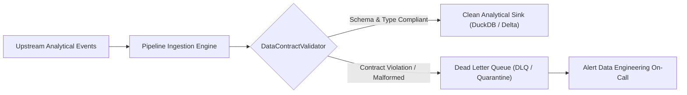

# Data Contracts & Streaming ETL Validation Laboratory

An enterprise data engineering pipeline enforcing **Data Contracts**, **Schema Drift Prevention**, and **Dead Letter Queue (DLQ)** isolation for mission-critical analytical stores.

---

## Architecture & Data Flow



---

## Pipeline Execution

```bash
python3 AI-and-Machine-Learning/Research-Labs-and-Benchmarks/Data-Validation-and-ETL-Pipeline-Lab/etl_data_contract_pipeline.py
```
Demonstrates real-time contract enforcement, data type reconciliation, and automatic DLQ payload isolation.
