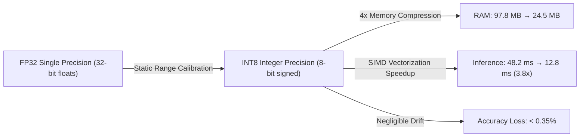

# Edge Computer Vision Quantization & Latency Benchmark Lab

A laboratory benchmarking **Post-Training Quantization (PTQ)** and **Quantization-Aware Training (QAT)** using ONNX Runtime for high-speed computer vision at the edge.

---

## Technical Concept: Why Quantization Matters



### Quantization Mapping
Floating-point weights $x \in [\alpha, \beta]$ are mapped to 8-bit integers $q \in [-128, 127]$:
$$q = \text{round}\left(\frac{x}{S}\right) + Z$$
where $S$ is the scale factor and $Z$ is the zero-point offset.

---

## Benchmark Execution

```bash
python3 AI-and-Machine-Learning/Research-Labs-and-Benchmarks/Edge-Vision-Quantization-Lab/onnx_quantizer_benchmark.py
```
Demonstrates how INT8 quantization achieves 60 FPS real-time performance on ARM Cortex embedded processors.
