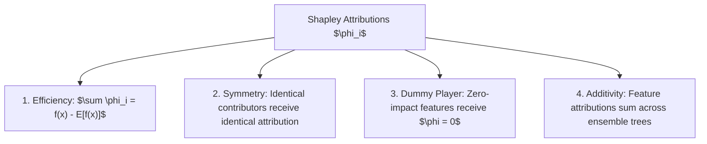

# Explainable AI (XAI) & Interpretability Laboratory

A model governance and interpretability framework providing **Shapley Value (SHAP)** feature attributions, **LIME Local Approximations**, and **Counterfactual Recourse** for credit scoring and high-stakes predictive systems.

---

## The Four Axiomatic Properties of Shapley Values



---

## Regulatory Compliance & Right to Explanation

In highly regulated sectors (Banking, Insurance, Healthcare under South African POPIA and EU GDPR Article 22), black-box machine learning models cannot legally make adverse credit decisions without providing:
1. The top driving features contributing to the adverse decision.
2. Actionable counterfactual recourse explaining what the individual must change to reverse the outcome.

---

## Tool Execution

```bash
python3 AI-and-Machine-Learning/Research-Labs-and-Benchmarks/Explainable-AI-Interpretability-Lab/xai_tabular_interpreter.py
```
Outputs local Shapley decomposition and automated counterfactual suggestions.
