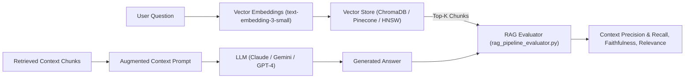

# RAG (Retrieval-Augmented Generation) & LLM Pipeline Evaluation Lab

A quantitative benchmark framework evaluating enterprise RAG architectures, chunking strategies, vector embeddings, and LLM answer fidelity.

---

## Architectural Mechanics



---

## RAG Triad Evaluation Metrics

1. **Context Precision**: Measures whether the retrieved chunks are actually relevant to the question, filtering out noise that can distract the model.
2. **Context Recall**: Measures whether the retriever gathered all critical ground-truth facts required to answer comprehensively.
3. **Faithfulness (Hallucination Detector)**: Confirms whether every claim made in the generated answer is strictly grounded in the retrieved context chunks.
4. **Answer Relevance**: Ensures the generated text directly answers the user's inquiry rather than digressing.

---

## Running the Benchmark

```bash
python3 AI-and-Machine-Learning/Research-Labs-and-Benchmarks/RAG-and-LLM-Evaluation-Lab/rag_pipeline_evaluator.py
```
Outputs structured metrics and flags any detected hallucinations.
